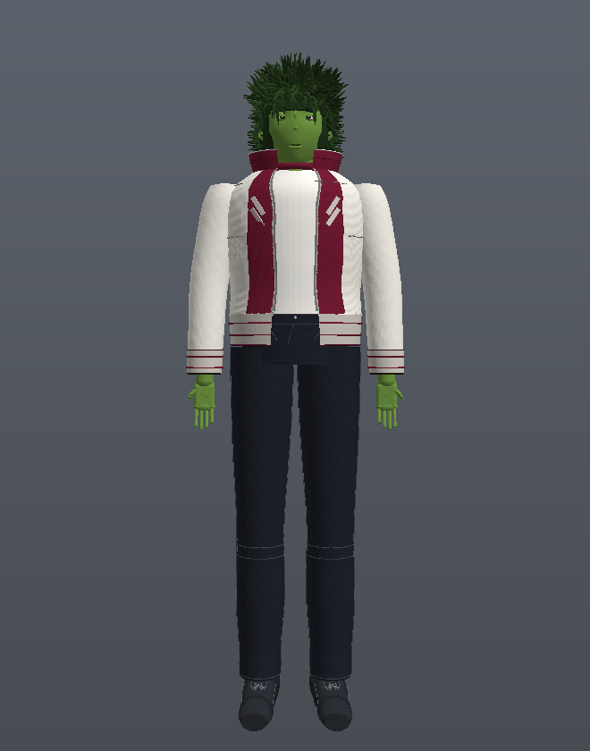

# بیست بوی — مدل سه‌بعدی کامل 🟢

**Beast Boy (Titans)** — یک مدل سه‌بعدی کاملاً procedural و پرجزئیات از شخصیت بیست بوی
(نسخه‌ی سریال Titans / لایو‌اکشن)، ساخته‌شده با Three.js — بدون هیچ فایل مدل آماده‌ی خارجی.



---

## اجرا

```bash
# هر وب‌سرور ساده کافی است
python3 -m http.server 8137 --bind 0.0.0.0
# یا
npx serve .
```

سپس `http://localhost:8137` را باز کنید.

## امکانات نمایشگر

- 🖱 **چرخش / زوم / جابه‌جایی** با ماوس (OrbitControls)
- 🎥 **دکمه‌های نمای آماده**: روبه‌رو، پشت، سمت راست، سمت چپ، چهره، تمام‌قد
  (همان چهار نمایی که در مرجع طراحی بود)
- 💡 **سه حالت نور**: استودیو، گرم، دراماتیک
- 🔁 چرخش خودکار، وایرفریم، روشن/خاموش کردن صحنه
- ⬇ **دانلود مدل به صورت GLB** (با متریال و بافت، آماده‌ی import در Blender/Unity/Maya)

## جزئیات مدل‌سازی

| بخش | جزئیات |
|---|---|
| **صورت** | جمجمه‌ی مجسمه‌شده با میدان‌های گاوسی (گودی چشم، استخوان ابرو، گونه، فک، چانه)، پلک‌های بالا/پایین جداگانه، عنبیه‌ی فیزیکی با بافت دست‌ساز، بینی ترکیبی، لب‌ها با کمان کوپیدن، گوش کامل (هلیکس/تراگوس/لاله) |
| **مو** | ~۸۰۰ دسته‌ی موی خمیده‌ی Instanced با جهت‌دهی ناحیه‌ای (تاج، ریش‌ریش، پهلو، پشت) + کلاهک زیرین با نویز |
| **کاپشن** | بمبر سفید با الله‌بخشی Loft، دهانه‌ی زیپ واقعی (نوار + دندانه‌های Instanced + زبانه)، پنل‌های زرشکی جلو، نیم‌طوق زرشکی پشت، شورون‌های «//»، یقه‌ی ایستاده با لبه‌ی سفید، سرآستین و دم‌پای ریب با نوارهای زرشکی، جیب‌های سینه، دوخت‌های دستی |
| **تیشرت** | سفید با یقه‌ی زرشکی (ringer) |
| **جین** | تیره با بافت تاویل procedural، چروک‌های زانو و انباشت روی مچ، دوخت‌های J زیپ و کنار، بندک کمربند، دکمه، جیب‌های پشتی + فلپ ران |
| **کفش** | رویه‌ی Loft محور-Z، توکپ، زیره‌ی Extrude با دوخط، بندهای ضربدری Instanced + گره، زبانه و یقه‌ی مچ |
| **دست‌ها** | کف دست، ۴ انگشت سه‌تکه با خم طبیعی، شست دوتکه، ناخن‌ها، چین کف دست |

## ساختار کد

```
index.html          رابط فارسی + importmap
vendor/             three.js (r160) + addons به صورت محلی
src/
  main.js           صحنه، نور، دوربین، UI، خروجی GLB
  materials.js      متریال‌های PBR
  textures.js       بافت‌های procedural (Canvas): پارچه، جین، ربان، عنبیه…
  helpers.js        جعبه‌ابزار Loft/Tube/Deform + وصله‌های همان‌سطح
  model/
    proportions.js  نقاط کلیدی بدن
    head.js         سر و اجزای صورت
    hair.js         موها
    torso.js        تیشرت + کاپشن + آستین + زیپ
    hands.js        دست‌ها
    legs.js         لگن و شلوار جین
    shoes.js        کفش‌ها
    beastboy.js     اسمبلی نهایی
```

حجم مدل: **~۳۲۰ هزار مثلث** (قابل مشاهده در گوشه‌ی رابط).

---

**یادداشت**: این یک فن‌آرت آموزشی است. بیست بوی (Beast Boy) متعلق به DC Comics است.
